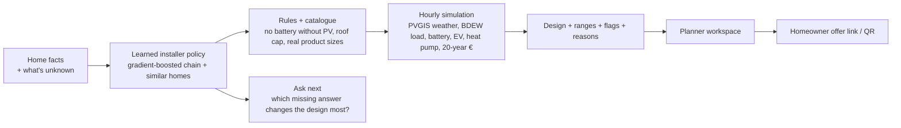

# Rhythm: Home Energy Designer

**An AI planner that designs home energy systems like the installer's best colleague, and says what it doesn't know.**
Built in 30 hours for the Reonic challenge at thinc! München 2026.

From a few facts about a home (annual consumption, people, heating, electric car, roof size if known), Rhythm proposes **PV (kWp), battery (kWh), heat pump (kW) and wallbox** the way the installer's own experts did on ~1,600 signed projects. Then it:
- checks the design with an **hourly simulation** (a year of weather, household load, battery, car, heat pump, 20-year economics),
- shows the **range experts chose for similar homes** and flags anything unusual,
- names the **1–3 questions that would change the design most** ("Ask next"),
- hands the homeowner an **offer link / QR** where they can compare only the options the planner approved.

## Results (honest, on projects the model never saw)
Trained on offers up to 2025, choices made on a Q4 2025 validation window, then scored once on **325 projects from 2026**.

| 2026 projects (n = 325) | Whole design right¹ | PV within ±20% | Battery within ±25% | Closeness² |
|---|---|---|---|---|
| Rule of thumb | 14.8% | 32.9% | 40.0% | 55.0 |
| Copy the installer's usual design | 20.6% | 42.5% | 47.4% | 61.1 |
| **Rhythm** | **20.9%** | **59.7%** | 47.4% | 61.0 |

¹ PV, battery, heat pump and wallbox all within tolerance of the expert's design. ² Average closeness to the expert design, 0–100.

**What this means:**
- **PV: +17 points** over the installer's own habit. That is the model's measurable edge.
- **Battery and whole design: a tie.** In the data, battery size follows the installer's package (≈ 0.93 kWh per kWp), not the household, so habit is hard to beat.
- **The ceiling is the missing data.** Near-identical homes got anything from 5.4 to 12.6 kWp, because the expert saw the roof and the budget and the export doesn't contain them. So Rhythm **asks** for that information instead of guessing.
- **Measured value of asking:**
  - Real annual kWh instead of the 4,500 kWh placeholder: **+9.8 points** whole design.
  - The roof size: up to **+12 points** (upper bound).

**Honesty checks** (run with every evaluation; see [Evaluation](#evaluation-and-the-test-lab)):
- With shuffled answers the model loses its edge, so it learns real signal.
- Across 20 random splits, ours minus the usual design on whole design is +0.6 ± 2.0 points, which is not distinguishable from zero. We say so.
- 2,000 random and extreme homes: 0 rule violations, 0 crashes.

## How it works



1. **Learned installer policy.** A chain of small gradient-boosted models decides heat pump → PV → battery → wallbox, each seeing the previous decision, because installers sell packages. It is trained on the real offers, with model choices made on the validation window only. A nearest-neighbour index provides "what did similar homes get" for ranges and flags.
2. **Rules and catalogue.** Hard rules (no battery without PV, existing heat pump stays, roof cap, battery-to-PV ratio) and snapping to sizes the installer actually sells.
3. **Hourly simulation.** It turns a design into self-consumption, autarky, savings, payback and a battery curve. It is the *second opinion* ("experts usually sell 10 kWh here; 5 kWh is the economic sweet spot"), deliberately not the sizing source: it matched experts worst of all methods we tried.
4. **Ask next (value of information).** For each missing or placeholder input, the engine re-designs the home under every plausible answer (one batched model call) and ranks questions by *probability the design changes × price swing*. The planner sees "How many modules fit the roof?", "Real annual kWh? 4,500 looks like a default".
5. **Language model, optional.** Claude Haiku only phrases text, parses intent and reads bills. **It never sizes anything**, and everything works without an API key.

## Run it
Prerequisites: Node 24+, pnpm 10+, Python 3.11+. The private Reonic export goes in `./dataset/<installer>/` and is never committed. Without it, the engine runs on clearly labelled synthetic data.

```bash
pnpm bootstrap   # once: Python venv + engine, web + contracts packages; with ./dataset also ETL + model training
pnpm dev         # engine on :8000 + web on :3000 → planner http://localhost:3000
pnpm test        # engine + eval tests, web lint
pnpm eval        # run ALL evaluation checks (~13 min), saved to eval/history; shown in the Test Lab
```
Presenter menu: **tap the logo three times** → Pitch mode or Lab results.
Rarely needed: `pnpm x:etl`, `x:train`, `x:select` (re-choose the model on validation), `x:contracts`, `x:web-build`, `x:correlations`.

## Evaluation and the Test Lab
- **Protocol:**
  - Train ≤ 2025-09-30; choose on 2025 Q4 (n = 232).
  - Refit ≤ 2025-12-31; score 2026 (n = 325).
  - Leave-one-installer-out and random splits as extra views.
  - Decisions are never made on the 2026 numbers. The Test Lab shows how often they were looked at.
- **`pnpm eval`** runs everything at once: validation, the 2026 exam, 20 repeated splits, per-installer splits, shuffled labels, a 2,000-home fuzz, and the value of each question. Each run is recorded with git branch and commit in `eval/history/runs.jsonl` (aggregates only).
- **`/lab`** shows the score over time per branch and runs all tests with one button (local dev only).
- How we try ideas without overfitting: [research/experiments.md](research/experiments.md) (protocol written before any experiment).

## Repository map
| Path | What |
|---|---|
| `services/engine/` | FastAPI engine: ETL (unit fixes for the export), policy (`engine/policy`), simulator (`engine/sim`), Ask next, API |
| `apps/web/` | Next.js 16 / React 19 / Tailwind 4 planner workspace, offer page, 3D house (react-three-fiber), Test Lab |
| `packages/contracts/` | OpenAPI schema + generated TypeScript types + fixtures: the only engine↔web contract |
| `eval/` | Evaluation harness, honesty checks, run history |
| `research/` | Evidence: data findings, installer workflow, battery and simulation research, source checks |
| `docs/` | [Index](docs/README.md): backlog, pitch numbers, design system, demo script, business case, deck |

## Data handling
The Reonic export is used only for this hackathon and stays on team machines: `dataset/`, `data/raw`, `data/processed` and trained models are gitignored. Only aggregates appear in docs, the UI and the run history. The evaluation is offline and deterministic.

## Limitations
- Two installers only. Heat pumps appear in ~2% of designs, so heat pump sizing is rule-based (heat demand ÷ full-load hours), not learned.
- No roof size, budget or location in the data, hence the PV uncertainty. We ask for it rather than guess.
- One reference weather site, and the hourly household profile is smoothed, so self-consumption is slightly optimistic.
- Prices are dated 2026 market ranges with sources. Inverter replacement and maintenance costs are placeholders.

## Team
Kian (product, contracts, docs) · Rhythm (engine) · Faris (frontend, 3D house) · iemko (evaluation, demo). Agent rules: [AGENTS.md](AGENTS.md).
