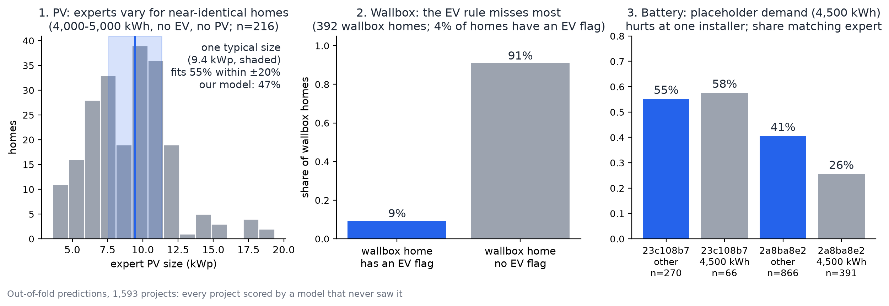

# Spec: where and why our designs differ from the experts

**Status:** done (see Findings) · **Workstream:** Model & eval · **Stretch goal** (Reonic PDF p. 7)

## Problem

A single accuracy score hides where the model fails. Judges want to see the pattern, and the team needs it to decide what to fix.

## Behaviour

From out-of-fold predictions (see Data and code), produce:
- Miss rates per component, broken down by home type: consumption band, heating type, EV yes/no, installer, and option count.
- The two or three largest patterns, each with a plausible reason. Examples: budget or preference we can't see, noisy line items, package-driven designs.
- One chart and one pitch slide: "Where we disagree with experts, and why".

## Data and code

- Input: out-of-fold predictions over all 1,593 projects (5-fold cross-validation, every project scored by a model that never saw it), not the 319-row test file. Reason: a single test split is too small to compare home types (some groups would have 10-30 homes). Folds are random; installer-held-out results are in `scripts/unseen_installer.py`.
- `scripts/deviation_analysis.py` (`--chart` also writes the figure; needs `pip install -e ".[analysis]"`). One command, real data only. Writes `reports/deviation_analysis.json`; the chart is copied to `docs/figures/deviation_chart.png`.

## Done when

- The breakdown runs from one command on the real data.
- Each pattern is written up with its count and rate, not just a description.
- Patterns we can't explain are listed as open, not guessed at.
- The slide uses real-data numbers only.

## Out of scope

Retraining the model on the deviations. This feature explains results; it does not change them.

## Findings (2026-11-07, out-of-fold, 1,593 projects)

Overall agreement with the expert: PV 49.6%, battery 40.1%, wallbox 76.0%, heat pump 99.2%, whole design 15.3%.
Agreement uses the evaluation rule: same include/exclude and, for PV, battery and heat pump, a size within tolerance (±20% PV, ±25% battery and heat pump; wallbox include only).

Headline caution: the PV figure is lifted by easy rows (no PV: 83% agree; size unknown, scored on include only: 74%). Where the expert PV size is a real number, agreement is about 40% (size from module counts 40.3%, n=1,084; from module rows 39.7%, n=63; from package names 52.6%, n=116).

### Pattern 1: PV size varies even for near-identical homes
- **What:** among 216 homes with 4,000-5,000 kWh demand (not 4,500), no EV, no existing PV, the expert PV size runs from 5.4 to 12.6 kWp (10th to 90th percentile, median 9.45). One fixed typical size would match within ±20% for 55% of them; our model matches 47%.
- **Not a systematic bias:** the median signed error is +2% to +7% in every consumption band except the 4,500 kWh placeholder rows (+16%, n=120). Overall 406 are too large and 240 too small.
- **Reason (supported):** the spread is in the experts' own choices, so the inputs we have cannot pin PV size down.
- **Open:** what drives it. Roof area and budget are not in the export, and either could explain it; not verified.
- **Honest note:** on this subgroup the model is below a fixed typical size (47% vs 55%, and the 55% uses the in-sample median, so it is optimistic). We have no evidence the model extracts more than the typical size here.

### Pattern 2: the wallbox rule cannot see most wallbox homes
- **What:** 392 homes (24.6%) have a wallbox, but only 3.9% of homes carry an EV flag, and only 9.2% of wallbox homes (36) have one. The rule missed 356 wallbox homes and added a wallbox where the expert had none for 26.
- **Not fixable by an "existing wallbox" rule:** of the 26 EV homes without a wallbox, only 1 already has one.
- **Open:** why wallboxes are sold without a recorded EV (a customer preparing for a future EV, or the EV flag rarely being filled, or the wallbox sitting in a different offer than the first). Cannot be settled from the export.

### Pattern 3: battery agreement is low at one installer, and placeholder demand hurts there
- **What:** battery agrees for 36% at `2a8ba8e2` (n=1,257) against 56% at `23c108b7` (n=336). Inside `2a8ba8e2`, homes with demand exactly 4,500 kWh (likely a placeholder) agree 26% (n=391) against 41% for other homes (n=866). At `23c108b7` there is no such difference (58%, n=66 vs 55%, n=270).
- **Reason (consistent with, not proven):** at `2a8ba8e2` the battery follows PV and PV follows demand, so a placeholder demand removes the signal. At `23c108b7` designs look package-driven, so demand matters less.
- **Rejected hypothesis:** more varied battery sizes at the weaker installer. The opposite holds: `2a8ba8e2` has 82% of batteries in three sizes (10, 5, 7 kWh) against 70% at `23c108b7`. Choosing the wrong one of 5, 7 or 10 kWh exceeds the ±25% tolerance, which makes the metric strict there.
- **Open:** the remaining gap on non-placeholder homes (41% vs 55%).
- **Correction to an earlier result:** `reonic-evaluate` said the model scores placeholder homes "no worse" (82 test rows). With 457 projects the battery result is clearly worse at one installer. The earlier sample was too small.

### Weaker signal: projects with several offers
Whole design agrees for 12.3% of projects with 2+ offers (n=300) against 16.0% with one offer (n=1,293). This points the way an option-choice problem would, but the difference is within noise. It supports asking Reonic which option was signed; it is not a finding.

## Slide: "Where we disagree with experts, and why"
- The experts disagree with each other: for near-identical homes their PV size spans 5.4-12.6 kWp, and one fixed typical size would match only 55% of them (our model: 47%).
- 9 in 10 wallbox homes have no EV on record: the data cannot tell us who will get a wallbox.
- A placeholder demand (4,500 kWh) cuts battery agreement from 41% to 26% at one installer.
- Open: roof area and budget (not in the export), why wallboxes appear without an EV, which offer was signed.
